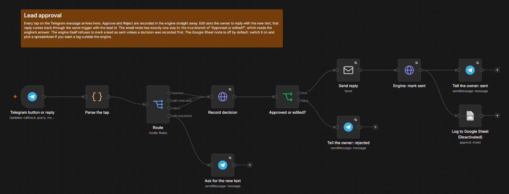
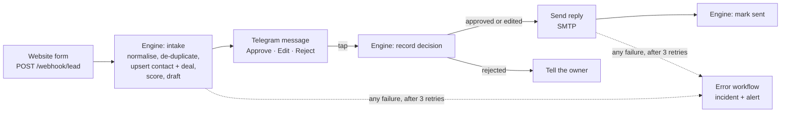
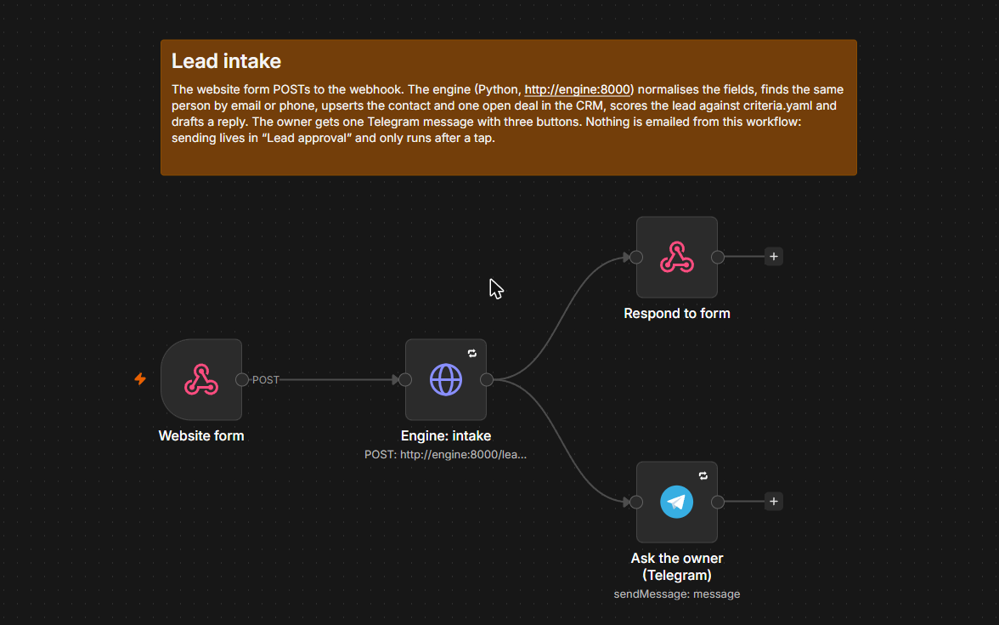
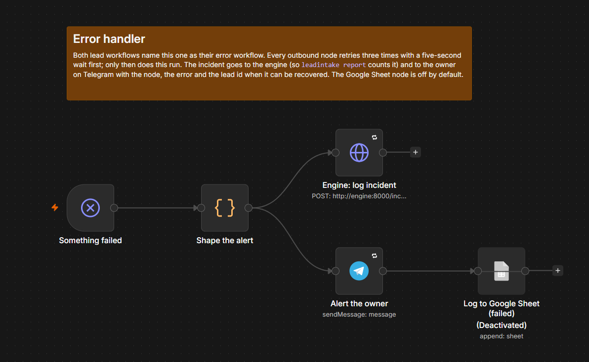

# n8n-lead-intake

**Website enquiry to CRM to an approved AI reply, with zero duplicate contacts. The owner approves every reply with one tap in Telegram.**

[](https://github.com/danilablagorodniy37/n8n-lead-intake/actions/workflows/ci.yml)
[](LICENSE)
[](docker-compose.yml)
[](pyproject.toml)

A small business gets enquiries from its website form. They land in a shared inbox, someone replies the next day, half of them never reach the CRM, and the ones that do are in there twice under two spellings of the same phone number. This kit is three n8n workflows and one Python service that turn that into: enquiry in, one contact and one deal in the CRM, a scored lead with a drafted reply on the owner's phone, and an email out the moment the owner taps **Approve**.



[Measured results](docs/report.md) · [the three workflows as JSON](workflows/) · [the owner's rules](criteria.yaml)

## What it does differently

1. **The same person is one contact, however they typed it.** Email is lower-cased and trimmed, phones are parsed to E.164 (`07700 900123`, `+44 (0)7700 900 123` and `00447700900123` are one number), and the CRM is searched by email *or* phone before anything is created. A known contact is updated and keeps its open deal; a double click on the form is flagged as a repeat, not a new lead. 200 synthetic enquiries from 120 people produced 127 contacts: 120 people plus 7 submissions with no usable contact details at all. Zero duplicates, and that number is a test, not a claim.
2. **The owner's rules live in a YAML file, not in a prompt.** `criteria.yaml` says which areas are the core patch, what budget is worth a visit, which enquiry types pay and which words mean "this week". Every lead gets a score out of 100 with the reasons spelled out in the Telegram message, so "why is this hot?" has an answer.
3. **A person approves every email.** The intake workflow has no email node. Sending lives in a second workflow whose email node has exactly one way in: the true branch of "Approved or edited?", which reads the engine's answer to the owner's tap. The engine refuses to mark a lead as sent unless a decision was recorded first. Both halves are tests: `tests/test_workflows_json.py` checks the graph, `tests/test_pipeline.py` the state machine.
4. **No invented figures.** The drafted reply is checked for pound amounts and percentages that were not in the enquiry. A draft that quotes a fee the owner never set is replaced by the template and the owner is told why.
5. **Failures are loud and counted.** Every outbound node retries three times, then the error workflow logs an incident in the engine and alerts the owner on Telegram with the node, the error and the lead id. `leadintake report` prints the count.
6. **Nothing runs on anyone else's server.** Self-hosted n8n in Docker Compose, the workflows exported as JSON into this repository, a Python service you can read in an afternoon. HubSpot on the free tier; the CRM is an adapter with five methods, so Pipedrive or a spreadsheet is a small file away.

## How it works



Three workflows in `workflows/`:



| Workflow | Trigger | What it does |
|---|---|---|
| `lead-intake.json` | Webhook `POST /webhook/lead` | Calls the engine, answers the form, sends the owner one Telegram message with three buttons |
| `lead-approval.json` | Telegram button tap or reply | Records the decision in the engine; sends the email only on approve or edit; confirms to the owner; optional Google Sheet row |
| `error-handler.json` | Error trigger | Logs the incident in the engine, alerts the owner, optional Google Sheet row |



The engine (`src/leadintake/`) is a FastAPI service with five routes that matter: `POST /leads`, `POST /leads/{id}/decision`, `POST /leads/{id}/sent`, `POST /leads/{id}/failed`, `POST /incidents`. Everything that needs a database or a test lives there: normalisation, the CRM upsert, scoring, drafting with the figures guard, and the approval state machine. n8n does what n8n is good at: triggers, the human in the loop, email, retries and the error path.

Why a Python service next to n8n at all? De-duplication needs a store you can query by two keys and a test that proves it; scoring needs a file the owner edits; and "nothing is sent without approval" needs to be enforced somewhere a stray node cannot bypass. Those three things are 400 lines of Python with 70 tests. The rest is wiring, and wiring is faster in n8n.

## Results

Measured by `leadintake seed --auto-approve && leadintake report` on the 200 synthetic enquiries in `seed/enquiries.jsonl`: 120 people writing in with the mess a real form produces (same email in a different case, the same mobile in four spellings, a second enquiry weeks later with a new phone, the double click), plus 7 submissions with no usable contact details. The full table is in [docs/report.md](docs/report.md).

| Metric | Result |
|---|---|
| Enquiries processed | 200 |
| Contacts in CRM / expected (120 people + 7 unmatched) | 127 / 127 |
| **Duplicate contacts created** | **0** |
| Enquiries recognised as a known contact | 73 |
| Double clicks recognised (same message within 24 h) | 21 |
| Open deals in CRM (one per contact, never a second one) | 127 |
| Hot / warm / cold by the owner's criteria | 79 / 90 / 31 |
| Engine time, form received to draft ready, p50 / p95 (template drafter) | 1 ms / 2 ms |
| Drafts replaced by the figures guard | 0 |

Two numbers are deliberately not in that table. **Reply time** is the owner's: the engine has the draft ready in milliseconds with the template and in a few seconds with a model, and the email goes out seconds after the tap, so form-to-reply is however long the owner takes to look at their phone. **LLM cost per lead** depends on the model; the report prints it from token counts at the prices configured in `.env`, and with the default template drafter it is zero. With `claude-haiku-5-5` and this prompt (about 700 input and 200 output tokens) it is in the region of $0.0002 per lead at the configured prices, an estimate until you run it with your own key.

The enquiries, the agency and the people are synthetic. A real form is messier in ways this seed does not cover: see Limitations.

## Run it yourself

### Everything, in Docker

```bash
git clone https://github.com/danilablagorodniy37/n8n-lead-intake && cd n8n-lead-intake
cp .env.example .env          # add TELEGRAM_BOT_TOKEN and TELEGRAM_CHAT_ID; the rest has defaults
docker compose up -d --build
```

This starts PostgreSQL, n8n (with the three workflows and two credentials imported on first run), the engine on http://localhost:8000 and [Mailpit](http://localhost:8025), a local mail catcher that receives every approved reply so you can see the emails without sending any.

1. Open http://localhost:5678, create the owner account n8n asks for, and open **Lead intake: form to CRM to owner approval**.
2. Post an enquiry:

   ```bash
   curl -X POST http://localhost:5678/webhook/lead -H 'Content-Type: application/json' \
     -d '{"name":"tom hughes","email":"Tom.Hughes@Example.com","phone":"07700 900123","area":"Staines","enquiry_type":"valuation","message":"Could you value my 3-bed semi? Thinking of selling this week."}'
   ```

   The Telegram message arrives with three buttons. Post the same enquiry again with the phone written as `+44 7700 900 123` and watch the message say "Known contact: updated in CRM, no second deal opened".
3. Tap **Approve and send**. The email appears in Mailpit, the engine marks the lead as sent, Telegram confirms.
4. `make seed-post` replays all 200 enquiries through the webhook (one every 0.2 s), then `docker compose exec engine leadintake report` prints the numbers.

**Telegram needs a public HTTPS URL** to deliver button taps, so on a laptop the buttons only work through a tunnel: run `cloudflared tunnel --url http://localhost:5678`, put the URL it prints into `WEBHOOK_URL` in `.env`, set `N8N_ACTIVATE_WORKFLOWS=true` and run `docker compose up -d` again. On a VPS, `WEBHOOK_URL` is your domain. Without a tunnel the intake half still runs end to end: the webhook answers, the engine processes, the message arrives on your phone.

### The engine on its own

```bash
python -m venv .venv && . .venv/bin/activate    # Windows: .venv\Scripts\activate
pip install -e ".[dev]"
make test                                         # 70 tests, no keys, no network
leadintake seed --auto-approve                    # 200 enquiries through the engine, approved and marked sent
leadintake report --markdown docs/report.md       # the numbers above
leadintake serve                                  # the API on http://127.0.0.1:8000
```

`LLM_PROVIDER=fake` (the default without a key) drafts from a template; set `ANTHROPIC_API_KEY` to have the model write the reply. The figures guard runs either way.

### Commands

| Command | What it does |
|---|---|
| `leadintake serve` | The API on :8000 |
| `leadintake seed --auto-approve` | Replay the 200 enquiries in-process, approve and mark sent |
| `leadintake seed --post URL` | Replay them through an n8n webhook |
| `leadintake seed --generate` | Regenerate `seed/enquiries.jsonl` (deterministic) |
| `leadintake report [--markdown PATH] [--json]` | Counts, duplicates against the seed, latency, cost, incidents |
| `leadintake status` | Provider, database, counts |
| `leadintake reset --yes` | Drop and recreate the tables |

## Configuration

Everything is an environment variable or a line in `.env`; `.env.example` lists them all with comments. `.env` is git-ignored, CI runs `scripts/check_secrets.py` over every tracked file, and `make hooks` installs the same check as a pre-commit hook. The ones that matter:

| Variable | Default | Notes |
|---|---|---|
| `TELEGRAM_BOT_TOKEN`, `TELEGRAM_CHAT_ID` | empty | The owner's approval channel; `.env.example` says how to get both |
| `CRM_PROVIDER` | `fake` | `fake` (tables in the engine's database) or `hubspot` with `HUBSPOT_ACCESS_TOKEN` |
| `LLM_PROVIDER` | `auto` | `anthropic`, `openai`, `fake`; `auto` picks by which key is set |
| `DRAFT_MODEL` | `claude-haiku-5-5` | Cheap and fast is right for a 100-word reply |
| `API_TOKEN` | empty | If set, n8n must send it as a bearer token (the compose file wires it through) |
| `DEFAULT_REGION` | `GB` | Country used to parse phone numbers without a prefix |
| `DUPLICATE_WINDOW_HOURS` | `24` | Same person, same message inside this window is a repeat, not a lead |
| `SMTP_*`, `REPLY_FROM` | Mailpit | Where approved replies are sent from |
| `WEBHOOK_URL`, `N8N_ACTIVATE_WORKFLOWS` | localhost, `false` | Set both once n8n is reachable over HTTPS |

### HubSpot

Create a private app in HubSpot with the `crm.objects.contacts` and `crm.objects.deals` read and write scopes, put its token in `HUBSPOT_ACCESS_TOKEN` and set `CRM_PROVIDER=hubspot`. The adapter searches contacts by email or phone, creates or patches the contact, looks for an open deal associated with it and creates one only if there is none. It is exercised against a mock of the v3 API in `tests/test_hubspot.py`; a run against your own free portal with ten test enquiries is the first thing to do with a real token.

## Project layout

```
workflows/            lead-intake.json, lead-approval.json, error-handler.json (import as they are)
n8n/                  import.sh and the credentials template the compose file uses on first start
src/leadintake/
  pipeline.py         intake: normalise -> de-duplicate -> upsert -> score -> draft; the approval state machine
  normalise.py        email, E.164 phone, budget in pounds, enquiry type
  scoring.py          criteria.yaml -> score, qualification, reasons, missing details
  draft.py            template or model, plus the figures guard
  crm/                fake (two tables) and hubspot (v3 API) behind one five-method interface
  api.py              the FastAPI routes n8n calls
  seed.py, report.py  the 200 synthetic enquiries and the numbers
criteria.yaml         the owner's rules (demo values for a fictional estate agency)
seed/enquiries.jsonl  the test set, with person_id as ground truth
tests/                70 tests, no network and no keys needed
```

## What I would add for production

- A per-day LLM cost cap and a rate limit on the webhook, so a bot hitting the form cannot run up a bill.
- A nightly job that re-checks the CRM for duplicates created by hand and merges them.
- Pipedrive and Google Sheets adapters behind the same CRM interface, and a Xero hook once a deal closes.
- A second approval channel (WhatsApp Business API or a one-page web queue) for owners who do not use Telegram.
- Retention: delete the raw enquiry after N days and keep the audit line.
- Growing `seed/enquiries.jsonl` from real anonymised enquiries, which is where the duplicate rules earn their keep.

## Limitations

- Phone parsing trusts the default region: a UK form that gets a French number without `+33` will reject it. Set `DEFAULT_REGION` per deployment.
- Deduplication is by email or phone only. The same person with a new email and a new phone is a new contact, as it is in every CRM.
- The Edit flow relies on the owner replying to the bot's prompt in Telegram; a plain message without a reply is ignored.
- Telegram's inline keyboard needs a public HTTPS webhook; there is no polling mode.
- One language (English), one owner, one Telegram chat per deployment.

## Author

Daniel Blago, Python and AI automation engineer, UK. [GitHub](https://github.com/danilablagorodniy37) · [Upwork](https://www.upwork.com/freelancers/~01cb77ac692f720f4e)

## Licence

MIT. Hollis & Grey, its areas, prices and every enquiry in the seed are fictional; phone numbers are from Ofcom's range reserved for fiction.
